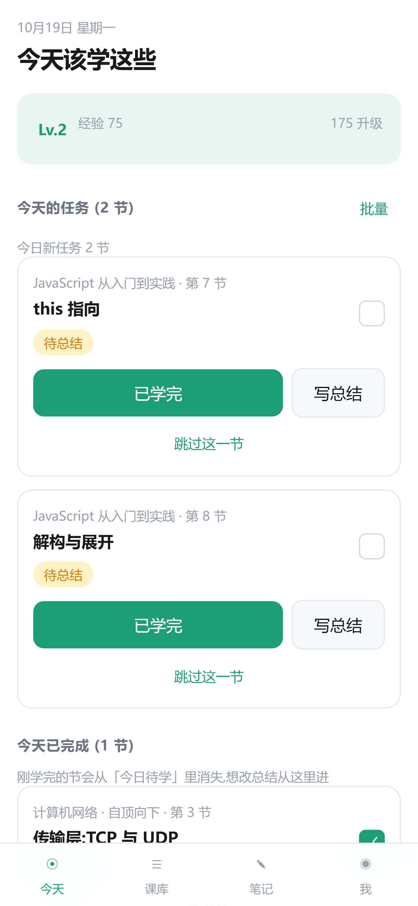
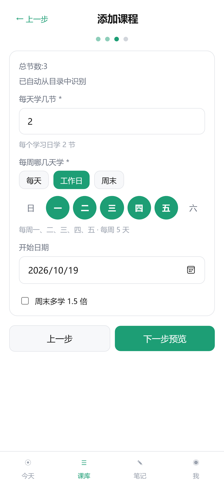
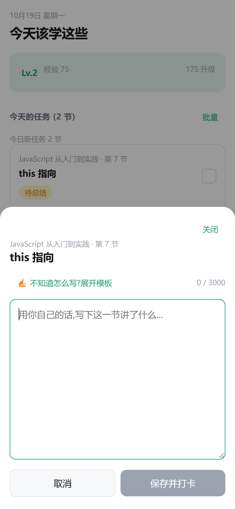
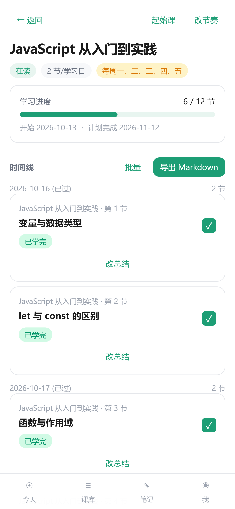

# 使用教程

> 面向第一次用这个软件的人。跟着走一遍,十分钟能上手。

---

## 怎么装起来

这个软件**在本地跑**,没有在线版。装 Node.js 18+,然后:

```bash
git clone https://github.com/xin080708/course-companion.git
cd course-companion
npm install
npm run build
npm run serve        # 打开 http://localhost:4174
```

Windows 用户构建完之后可以直接双击项目根目录的 **`launch.cmd`**,自动起服务并用 Edge 应用模式打开。

---

## 0. 它和别的学习 App 有什么不一样

大部分学习软件记录的是「你学过了」——进度条、连续天数、徽章。

这个软件只较真一件事:**你看完视频想点「已学完」,它会弹出一个框,不写下总结就打不了卡。**

写不出来,说明没真懂,回去重看。

其余所有功能——排期、复习提醒、热力图、导出——都是围着这一个动作转的。

---

## 1. 第一次打开

打开后是「今天」页,长这样:



底部四个 tab,各管一件事:

| Tab | 干什么 |
|---|---|
| **今天** | 今天该学哪几节、到期的复习、今天已完成 |
| **课库** | 加课、看所有课程进度、进课程详情 |
| **笔记** | 所有写过的总结,可搜索、可导出 |
| **我** | 复习设置、每日提醒、学习复盘、数据备份 |

刚装好是空的,先加一门课。

---

## 2. 加第一门课

**课库 → 添加课程**,分三步。

### 第 1 步:课程信息

填标题。如果是 B站 的课,把链接粘进来点「⚡自动抓取」,目录会自动填好。

### 第 2 步:目录

一行一节,可以粘整份目录进去点「解析目录」。软件会自动清洗掉这些垃圾:

- `【完结】`、`【高清】` 这类前缀
- UP 主名字
- `01` `P02-` `第3节` 这类编号
- 重复项、`_bilibili` 尾巴

解析完能看到「识别到 N 节」。不满意可以直接在文本框里改。

> **更快的办法**:用书签栏工具。见下面第 7 节。

### 第 3 步:节奏(重点)



- **每个学习日学几节** —— 比如 2 节
- **每周哪几天学** —— 这是很多人最需要的功能:
  - 点「**工作日**」= 只在周一到周五排,周末不占用
  - 点「**周末**」= 只在周六周日排
  - 或者自己点那几个圆钮,比如只排**周一 / 周三 / 周五**
  - 全选就是每天
- **开始日期** —— 默认今天
- 周末多学 1.5 倍 —— 勾上后周末那天多排 50%(只在周末被选中时有用)

点「下一步预览」能看预计哪天学完、前 10 节的时间线。确认没问题点「开始学习」。

---

## 3. 每天怎么用

### ① 打开「今天」

会看到今天该学的节。卡片上标着来自哪门课、第几节、待总结还是已总结。

### ② 去平台看视频

软件不管视频在哪看,B站、慕课、公司内训都行。

### ③ 回来点「已学完」

**如果你还没写总结,它不会让你打卡,而是弹出编辑器:**



用你自己的话写。不需要写得漂亮,但要能回答:

- 这一节讲了什么?
- 你学到了什么关键概念 / 操作 / 误区?
- 有什么还没弄懂的?

点「✍ 不知道怎么写?展开模板」会给一个结构提示。支持 Markdown。

写完点「**保存并打卡**」= 保存总结 + 标记完成 + 加经验。

> 总结每 1.5 秒自动存一次草稿,关掉再打开不会丢。

### ④ 学完一节,这一节就从「今日待学」消失

它会落到下面的「**今天已完成**」区块里。想改总结从那进。

---

## 4. 当天没学完会怎样

**不会消失,只会顺延。**

没点「已学完」的节,第二天会出现在「逾期未学」组里(带逾期标记),排在今日新课前面。一直没学就一直顺延,直到你学完或主动跳过。

落后不可怕,软件会帮你记着。但也别想赖掉——账永远在那。

**实在不想学这一节**,点「跳过这一节」。它会进「已跳过」区块,后面的任务自动往前顶。想捞回来随时点「取消跳过」。

---

## 5. 复习提醒

学完一节课后,软件会按 **1 / 3 / 7 / 14 / 30 天** 自动排复习点(间隔可在「我 → 复习设置」里改)。

到期那天,「今天」页顶部会冒出「今日回顾」,把当时写的总结推到你面前。看完点「已回顾」即可。

> 这个功能的重点不是让你重看视频,而是**让你重读自己写的那段话**。很多时候你会发现当时的理解是错的——那才是真正的进步时刻。

---

## 6. 看进度和复盘

### 单门课:课库 → 点课程



能看到进度条、计划完成日、完整时间线。已学完的节可以「改总结」,没学完的可以「改节奏」「起始课」「批量跳过」。

### 整体:「我 → 学习数据 → 详细复盘」

16 周热力图、连续天数、本周报告、每门课的健康度(正常 / 落后 / 停滞)和预计完成日。

---

## 7. 用书签栏一键抓 B站 目录

比手动复制目录快得多。

1. 打开软件 →「我」→「B站 目录工具」,把那个书签**拖到浏览器书签栏**
2. 打开 B站 的课程 / 合集页面
3. 点书签栏上那个「📚抓取B站目录」
4. 回到软件,顶部会出现「去创建」,点它 —— 标题和目录都已经填好了

如果书签没反应,B站 改版了。备选方案:把视频链接粘到加课第 1 步,点「⚡自动抓取」;或者干脆手动复制目录。

---

## 8. 改总结

写错了、想补充、过两周有了新理解 —— 随时能改。**改总结是纯编辑:不重复加经验、不改你当初的完成日期。**

三个入口:

| 入口 | 怎么走 |
|---|---|
| 今天页 | 学完的节在「**今天已完成**」区块里,点「改总结」 |
| 课程详情页 | 课库 → 课程 → 那一节点「改总结」 |
| 笔记页 | 笔记 → 点课程 → 那节右上角「改总结」 |

打开后原有内容已经填好,改完点「**保存修改**」(不是「保存并打卡」)。

---

## 9. 导出笔记 / 备份数据

**导出 Markdown**:笔记页 →「多课导出」(多门课合成一份),或课程详情 →「导出」(只导这一门)。产出带课程信息、每节标题 + 日期 + 你的总结、学习时间线,可直接丢进 Typora / Obsidian / VS Code。

**备份 JSON**:「我 → 导出 JSON 备份」,全量数据一个文件。

> ⚠️ 换电脑、清浏览器缓存、换浏览器都会导致数据看不到。**建议每月备份一次。**

---

## 10. 装成 App(可选)

软件是 PWA,可以装到桌面或手机,用起来和原生 App 差不多,而且离线可用。

**电脑(Edge / Chrome)**:打开软件地址 → 地址栏右边的「安装」图标 → 桌面出现图标,双击即开,没有地址栏。

**安卓手机**:用 Chrome 打开 → 菜单 →「添加到主屏幕」。

**Windows 用户**还有一条捷径:项目根目录的 `launch.cmd`,双击会自动起本地服务并用 Edge 应用模式打开。第一次用之前要先 `npm run build`(见 [README](../README.md#快速开始))。

> 装好后**只用桌面 App 读写数据**,别和浏览器里的 `localhost:4174` 混用——存储是分开的。

---

## 11. 常见问题

**数据存在哪?会上传吗?**
全部存在你浏览器本地的 IndexedDB 里,数据库名 `courseAppDB`。没有服务器、没有账号、没有任何网络请求(除了你自己点「抓取 B站 目录」时)。代码是开源的,你可以自己查。

**换了端口 / 地址,数据不见了?**
浏览器的存储按「地址 + 端口」隔离。`localhost:4174` 和别的端口算两个不同站点,数据各存各的。固定用 `http://localhost:4174` 就不会遇到。

**B站 目录抓不出来?**
多半是平台改版了。先用加课第 1 步的「⚡自动抓取」试试,不行就手动复制目录——解析器对格式很宽容,一行一节就行。

**能不能多设备同步?**
不能,这是设计选择。多设备同步意味着要账号、要服务器、要相信别人保管你的数据。这个软件的选择是:数据只在你手里,代价是自己备份。

**总结必须写多少字?**
没下限,写一句「这一节讲的是闭包,就是函数记住它出生的作用域」也算。但骗自己没意义——**写不出来说明没懂**,这才是它挡住你的原因。

---

## 12. 它不适合谁

老实说:

- 想要「打卡领积分、排行榜、和好友比拼」的 —— 这里只有 XP 和徽章,而且很克制
- 想要「AI 自动总结视频内容」的 —— 这个软件**刻意不生成任何内容**,总结必须是你自己的话,否则整个设计就失效了
- 想要多设备云同步的 —— 见上面
- 只想记录「我看过了」、不打算动笔的 —— 它第一天就会让你烦

如果以上都不是你,那它大概会很好用。

---

有问题欢迎开 issue。这是个人项目,回复可能不快,但会看。
